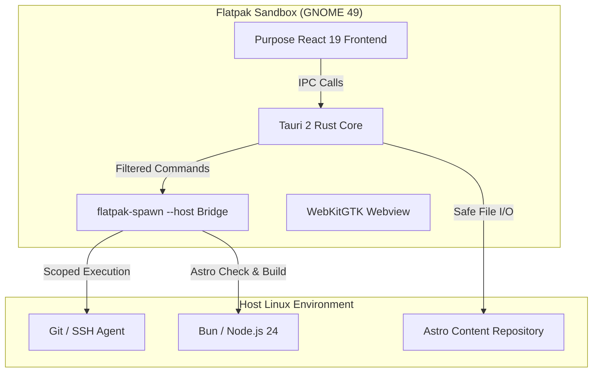

I built **Purpose** as a dedicated desktop editor for this publication. It pairs a **React 19 + TypeScript** interface with a native **Tauri 2 + Rust** shell, packaged as a sandboxed **Flatpak** for Linux.

When drafting long technical articles, general-purpose text editors like VS Code or generic Markdown tools often fall short. They do not understand custom Astro content schemas, they clobber YAML frontmatter formatting when rewriting metadata, they fail to preview custom interactive components, and they make it easy to inadvertently violate editorial rules (such as our strict avoidance of em dashes).

In version 0.2.0, I overhauled the application from an initial prototype into **Purpose**: an archival, focused writing studio that directly mirrors the site's exact visual system, typography, and Satteri markdown pipeline.

---

## The Core Technical Requirements

Writing for an independent engineering journal introduces specific workflow demands:

1. **Frontmatter Integrity**: Edits to the Markdown body must preserve the exact byte layout of original YAML frontmatter. Modifying structured fields (such as publication date, project status, or tags) must rewrite only the frontmatter block without re-serializing or mangling untouched custom fields.
2. **MDX Component Synchronization**: The editor must understand and offer snippets for all 13 interactive engineering components on the site, including `<EngineeringNote>`, `<EquationBlock>`, `<Measurement>`, `<LinePlot>`, and `<DataTable>`.
3. **Archival Monograph Aesthetics**: The editor should not look like a generic IDE. It adopts the site's warm book paper palette (`#F8F6F0`), high-contrast slate-graphite dark mode (`#161614`), display serif typography (`Fraunces`), and monograph reading serif (`Newsreader`).
4. **Sandboxed Native Distribution**: On Fedora Linux, the application should install as a containerized Flatpak (`com.glitchslayed.site-editor`) with minimal host permissions, delegating Git, build checks, and dev server execution across a secure bridge.

---

## Architectural Breakdown

### 1. The Safe Command & File Bridge
Inside the Flatpak sandbox, Purpose does not request blanket access to the user's home directory. Instead:
- Repository directories are selected via the desktop document portal.
- Subprocess execution (`git check`, `git diff`, `npm run build`, `astro dev`) is mediated by `flatpak-spawn --host` with strict argument whitelisting in Rust. Arbitrary shell execution is impossible.
- When committing changes, Purpose validates metadata schemas, checks for forbidden corporate buzzwords and em dashes, stages only the modified files within content directories, and pushes through the existing Git configuration.

### 2. Satteri & KaTeX Approximation Engine
A major challenge with desktop Markdown editors is preview latency. Evaluating full React MDX islands inside the editor would require running a heavy Node.js runtime inside the desktop view.

Purpose solves this by implementing an approximation pipeline:
- **Math**: LaTeX equation delimiters (`$...$` and `$$...$$`) are rendered immediately with KaTeX-matched typographic styles.
- **Engineering Callouts**: `<EngineeringNote>` elements render with active kind badges (`decision`, `assumption`, `limitation`, `observation`).
- **Equations & Specs**: `<EquationBlock>` and `<Measurement>` tags render formatted specification cards with uncertainty bounds.
- **Satteri Delta Badges**: Table annotations like `(+12.4%)` and `(-3.2%)` automatically receive emerald and crimson differential badges.
- **Live Server Integration**: When authors want to interact with live WebGL plots or uPlot canvases, a single button in the status bar spins up the site's local Astro preview server at `localhost:4321`.

### 3. Real-Time Document Outline (TOC)
Long monographs often exceed 4,000 words. Purpose parses heading tokens (`#`, `##`, `###`) in real time, building a hierarchical table of contents drawer. Clicking any outline node jumps the editor cursor and scrolls the preview directly to that section.

### 4. Interactive Tag Management
Instead of fragile comma-separated strings, metadata tags are managed through interactive chips. As authors type, Purpose scans all existing articles and projects across the workspace to offer instant autocomplete suggestions, preventing tag fragmentation across the site.

---

## Development & Availability

Purpose is maintained as an open-source companion in `editor/` (tracked as a git submodule to the main site repository) and published under `GlitchSlayed/site-editor`.

Native releases are compiled inside the GNOME 49 SDK container and distributed as standalone Flatpak bundles via GitHub Actions.
